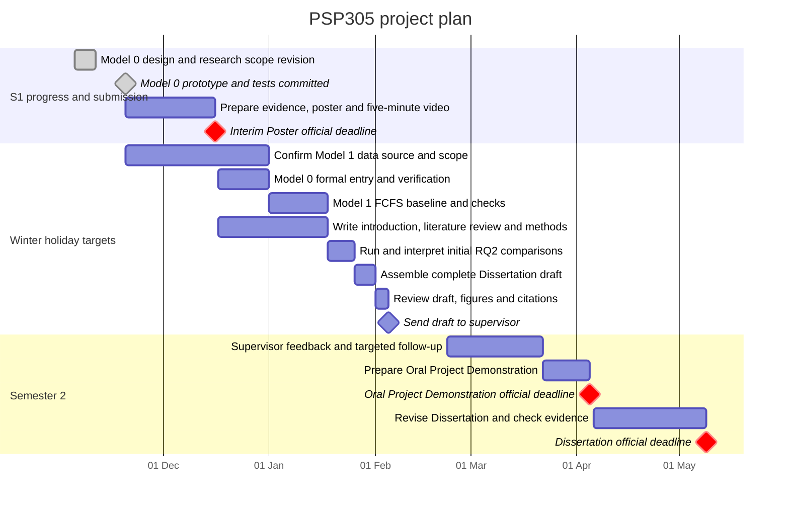

# Gantt chart

The chart covers S1, the winter holiday and Semester 2. The **2027-02-05 Dissertation draft** is a project milestone for supervisor review. Dates with official deadlines are listed below with the time of day. Planned bars show target work windows.

## Milestones

| Date | Milestone |
| --- | --- |
| **2026-12-16 12:00** | Official Interim Poster and video deadline. |
| 2026-12-31 | Target for Model 0 verification and agreement on Model 1 data or the scope of a literature-based scenario. |
| 2027-01-25 | Target for first RQ2 results, after checking the Model 1 baseline and agreeing the comparison policy and experiment design. |
| 2027-01-31 | Target for a complete Dissertation draft with traceable results, sources and clearly stated limitations. |
| **2027-02-05** | Internal target to send the draft to the supervisor before Lunar New Year. |
| **2027-04-05 23:59** | Official Oral Project Demonstration deadline. |
| **2027-05-09 23:59** | Official Dissertation deadline. |

See [project progress](../PROJECT_PROGRESS.md) for evidence behind the completed work and [research context](../docs/RESEARCH_CONTEXT.md#schedule) for the official dates. If data access or verification delays the comparison, record the resulting scope change and base the draft on the evidence available.
